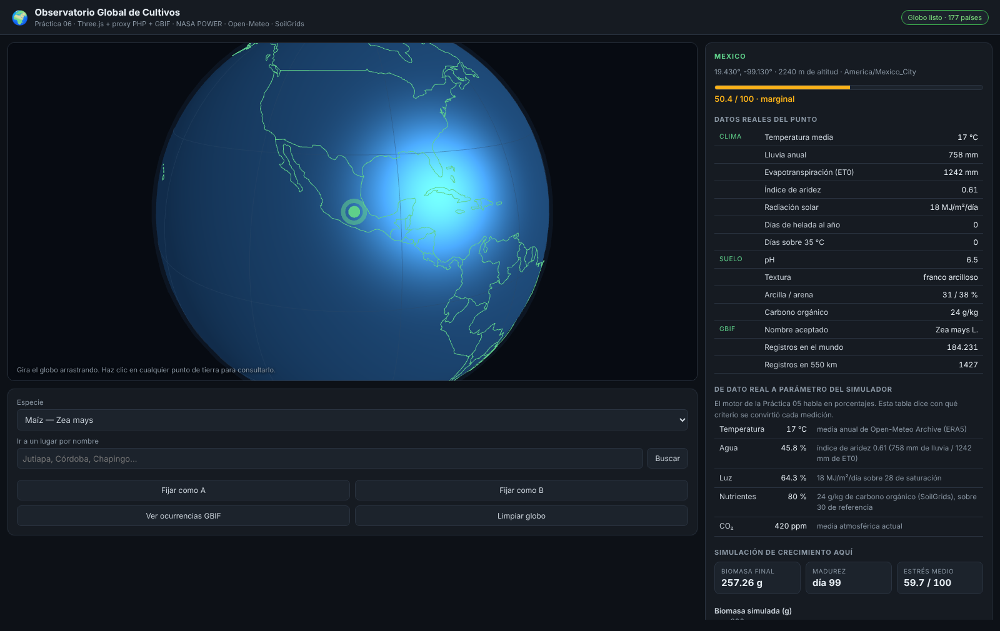

# Práctica 06 — Observatorio Global de Cultivos

Ricardo Melgoza y Rebeca Arciga

Visor geoespacial que cruza datos reales de clima, suelo y biodiversidad con el
motor de crecimiento vegetal de la Práctica 05. Haces clic en cualquier punto
del planeta y te dice qué se puede sembrar ahí, con qué rendimiento esperado y
con qué riesgos.



## Instalación

Tres pasos. **No hace falta Composer, ni MySQL, ni ningún framework.**

**1.** Copia la carpeta a `C:\xampp\htdocs\practica06` (o a donde sirvas).

**2.** Comprueba que PHP tiene cURL activado. En `C:\xampp\php\php.ini` debe
estar sin punto y coma:

```ini
extension=curl
```

Si la tocas, reinicia Apache. Sin cURL el proxy no puede salir a internet y no
funciona nada.

**3.** Abre `http://localhost/practica06/` y, si algo falla,
`http://localhost/practica06/api/diagnostico.php`.

> **Requisito real:** el servidor necesita salida a internet. No el navegador:
> **el servidor**. Si la red de la universidad filtra el tráfico saliente, el
> diagnóstico lo dirá y el visor seguirá dibujando el globo, pero los paneles
> saldrán vacíos.

## Por qué no hay base de datos

La Práctica 05 tenía MySQL porque había algo relacional que guardar:
simulaciones, sus mediciones y sus decisiones, con consultas que cruzaban
corridas de distintas sesiones. Aquí no. Lo que hay es:

- **el catálogo de especies**, seis filas que no cambian → `datos/especies.json`;
- **los contornos de los países**, que tampoco cambian → `datos/paises.json`;
- **la caché de las APIs**, que son pares petición → respuesta con fecha de
  caducidad → archivos en `cache/`.

Nada de eso pide un motor relacional. Meter MySQL habría añadido un `composer
install`, un `schema.sql`, un usuario de base de datos y tres cosas más que
pueden fallar en la instalación, a cambio de nada. Si más adelante hubiera que
guardar el histórico de análisis por usuario, ahí sí volvería una tabla.

## Las tres capas

| Capa | Archivos | Qué hace |
|---|---|---|
| Datos externos | `api/proxy.php`, `api/fuentes.php`, `api/config.php` | Consume las cuatro APIs, cachea y normaliza |
| Geoespacial | `js/globo.js`, `datos/paises.json` | Globo 3D, marcadores, nube de ocurrencias, arcos |
| Decisión | `js/idoneidad.js`, `js/motor.js`, `js/modelos.js` | Traduce datos a parámetros, puntúa y recomienda |

## El proxy: por qué el navegador no llama a las APIs

Todo el tráfico externo pasa por `api/proxy.php`. Cuatro razones, en orden de
importancia:

1. **Credenciales.** Una clave en el JavaScript es una clave pública: se ve con
   Ctrl+U. En este proyecto las cuatro APIs son abiertas, pero `api/config.php`
   ya tiene el arreglo `CLAVES` preparado, y ahí es donde va la primera que
   pida una. El archivo lo lee PHP; el navegador nunca lo descarga.
2. **CORS.** Varias de estas APIs no mandan `Access-Control-Allow-Origin`, así
   que un `fetch` desde el navegador fallaría sin más. Desde PHP no hay CORS.
3. **Caché.** Veinte alumnos pulsando el mismo punto generan **una** llamada,
   no veinte. Las APIs públicas tienen límites de uso y respetarlos es parte
   del trato.
4. **Normalización.** Cuatro APIs, cuatro formatos distintos. El frontend
   recibe uno solo, en español y con unidades resueltas.

### Rutas del proxy

```
api/proxy.php?fuente=sitio&lat=19.43&lon=-99.13&especie=Zea mays
api/proxy.php?fuente=lugar&lat=…&lon=…
api/proxy.php?fuente=clima&lat=…&lon=…
api/proxy.php?fuente=nasa&lat=…&lon=…
api/proxy.php?fuente=suelo&lat=…&lon=…
api/proxy.php?fuente=biodiversidad&especie=Zea mays&lat=…&lon=…
api/proxy.php?fuente=buscar&q=Jutiapa
```

`sitio` es la que usa el visor: pide las cuatro fuentes a la vez y **captura el
error de cada una por separado**. Que SoilGrids no tenga datos de un islote no
debe impedir ver el clima. La respuesta trae lo que sí llegó y un arreglo
`fallos` con lo que no.

Todas contestan `{ok: true, datos: …}` o `{ok: false, error: "…"}`.

## Las cuatro APIs y qué se saca de cada una

| API | Qué da | Normalización que hace falta |
|---|---|---|
| **Open-Meteo Archive** | Serie diaria de 5 años (ERA5) | Las normales se calculan aquí: medias, acumulados anuales, días de helada, días sobre 35 °C, índice de aridez |
| **NASA POWER** | Climatología mensual desde 1981 | Viene como `{JAN:…, …, ANN:…}`; la lluvia está en mm/día y hay que multiplicar por 365 |
| **SoilGrids (ISRIC)** | pH, arcilla, arena, limo, carbono orgánico a 250 m | Los valores son **enteros multiplicados por un factor**: pH 65 significa 6.5. El factor se lee de `d_factor` en la propia respuesta |
| **GBIF** | Registros de ocurrencia de especies | Primero el nombre científico a `usageKey`, luego los conteos y por último los puntos |

Se usan dos fuentes de clima a propósito: Open-Meteo da la serie cruda, con la
que calculamos nosotros, y NASA POWER da la climatología ya procesada. Que dos
fuentes independientes coincidan es la mejor señal de que el dato es bueno.

## El globo

Three.js puro, **sin ninguna textura de imagen**. La geografía son los
contornos de 177 países dibujados como líneas, unos 20.600 vértices, todos en
un único `LineSegments`: un objeto, una llamada de dibujo por frame. Si cada
país fuera un objeto serían 177 llamadas.

- **Proyección**: `aVector(lat, lon)` convierte coordenadas a un punto de la
  esfera, y `aCoordenada(v)` hace el camino inverso. Es lo que permite saber
  dónde hiciste clic: el raycaster da un punto 3D y de ahí sale la latitud.
- **Ocurrencias de GBIF**: cientos de puntos en un único `THREE.Points` con un
  `BufferGeometry`. Crear una esfera por registro tumbaría el navegador.
- **Arcos A/B**: curva de Bézier cuyo punto de control se empuja hacia fuera en
  proporción a la distancia. Una recta atravesaría el planeta por dentro.

### Geocodificación inversa sin API

Open-Meteo solo geocodifica **hacia adelante** (nombre → coordenadas), así que
el camino inverso se resuelve en el servidor con los mismos polígonos que
dibujan el globo, mediante un algoritmo de cruce de rayos. Sale gratis, es
instantáneo y funciona aunque no haya internet. El primer anillo de cada
polígono es el contorno y los demás son huecos, por eso hay que descartarlos.

## De dato real a parámetro del simulador

El motor de la Práctica 05 habla en porcentajes de luz, agua y nutrientes; las
APIs hablan en MJ/m²/día y milímetros. La traducción está en
`Idoneidad.aParametros()` y **cada conversión se muestra en la interfaz con su
criterio**, porque una conversión sin justificar es un número inventado.

| Parámetro | De dónde sale | Criterio |
|---|---|---|
| Temperatura | Media anual de Open-Meteo | Directa |
| Agua % | Índice de aridez (lluvia / ET0) | Aridez 1.0 → 75 % de humedad, que es el riego óptimo típico |
| Luz % | Radiación solar | 28 MJ/m²/día se considera saturación |
| Nutrientes % | Carbono orgánico del suelo | 30 g/kg se considera suelo plenamente fértil |
| CO₂ | Fijo en 420 ppm | Media atmosférica actual |

## El índice de idoneidad

```
total = 0.55 · clima + 0.30 · suelo + 0.15 · evidencia
```

- **Clima** es el complemento del estrés que ya calculaba el motor de la
  Práctica 05, ahora alimentado con datos reales.
- **Suelo** combina la distancia del pH al óptimo de la especie (60 %) con si
  la textura está entre las que tolera (40 %).
- **Evidencia** son los registros de GBIF en 550 km a la redonda, en escala
  logarítmica: la diferencia entre 0 y 100 registros importa mucho más que
  entre 10.000 y 10.100.

Se vuelve a aplicar la **ley del mínimo de Liebig**: el total no puede superar
en más de un 25 % al peor de clima y suelo. Un sitio con clima perfecto y suelo
imposible no es un sitio medianamente bueno, es un sitio malo.

### Dos cosas que el índice declara en voz alta

**Sin clima no hay nota.** Si las APIs no devuelven clima, el resultado es
`sin datos`, no un número. Esto no es un detalle: el traductor rellena los
huecos con los óptimos de la especie, así que un punto sin datos daría estrés
cero y puntuaría **100**, ganando todas las comparaciones. Un lugar del que no
sabemos nada no puede ser el mejor lugar. Por el mismo motivo, la comparación
A/B se declara **no concluyente** si a cualquiera de los dos le falta el clima.

**GBIF mide muestreo, no solo biología.** Europa aparece densísima y buena parte
de África vacía, y eso dice más del esfuerzo de registro que de las plantas. Por
eso la evidencia pesa solo 0.15 y no entra en el techo de Liebig: que nadie haya
registrado maíz en un valle no impide que el maíz crezca ahí.

## Qué se puede hacer

- **Clic en cualquier punto** → clima, suelo y biodiversidad reales, índice de
  idoneidad, decisiones geo-agronómicas y curva de crecimiento simulada.
- **Buscar un lugar por nombre** → geocodificación con Open-Meteo y viaje del
  globo hasta ahí.
- **Ver ocurrencias GBIF** → los registros reales de la especie sobre el globo.
- **Comparar A/B** → dos puntos del mundo, con arco entre ellos, las dos curvas
  superpuestas y un veredicto.
- **Ranking de especies** → las seis del catálogo ordenadas por idoneidad en
  ese punto, con los mismos datos de clima y suelo.

## Estructura

```
practica06/
├── index.html
├── style.css
├── README.md · RESPUESTAS.md
├── captura.png
├── api/
│   ├── proxy.php          router único, sin framework
│   ├── fuentes.php        una función por API + geocodificación inversa
│   ├── config.php         claves, caché, cURL
│   └── diagnostico.php    prueba las cuatro APIs en vivo
├── datos/
│   ├── especies.json      catálogo (sustituye a la tabla de la Práctica 05)
│   └── paises.json        177 contornos, 156 KB
├── cache/                 respuestas cacheadas (se llena sola)
└── js/
    ├── api.js             cliente del proxy
    ├── globo.js           Three.js
    ├── modelos.js         los cuatro modelos de la Práctica 05
    ├── motor.js           estrés y crecimiento de la Práctica 05
    ├── idoneidad.js       traducción, puntuación y reglas geo
    ├── grafica.js         Chart.js
    └── app.js             orquestación
```

## Problemas frecuentes

**Todo vacío y el diagnóstico en rojo** — el servidor no tiene salida a
internet, o falta `extension=curl` en `php.ini`.

**Una sola fuente falla** — es normal y está previsto. SoilGrids no tiene datos
en el mar ni en algunos desiertos, y a veces tarda demasiado. El panel lo marca
en amarillo y sigue con las demás.

**Todo va lentísimo la primera vez** — son las cuatro APIs en serie. La segunda
consulta del mismo punto es instantánea: es la caché. Para forzar llamadas
nuevas, borra los archivos de `cache/`.

**El globo no aparece** — sin internet tampoco cargan Three.js ni Chart.js desde
el CDN. El resto de la página sí se dibuja.

## Dependencias

- **Three.js 0.128** y **OrbitControls** desde CDN
- **Chart.js 4.4** desde CDN
- **PHP 7.4+ con cURL**. Nada más.

Los contornos de países vienen de Natural Earth (dominio público) a través del
paquete `world-atlas`, convertidos de TopoJSON a un GeoJSON reducido.
